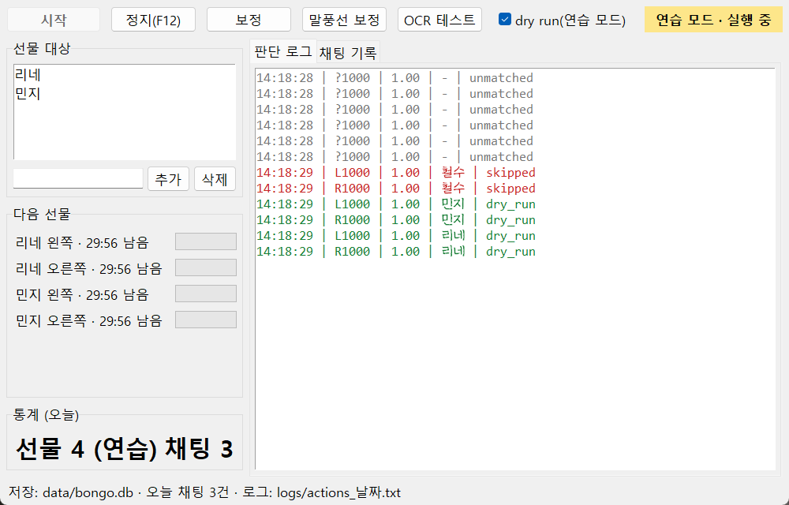

# Bongo Cat 자동 선물 헬퍼

Steam 『Bongo Cat』 로비에서 **지정한 이름의 고양이에게만** 선물(1000) 아이콘을 자동으로 누르고, 채팅 말풍선을 기록하는 Windows 프로그램입니다.
화면 캡처 + 이미지 매칭 + 한국어 글자 인식(RapidOCR) + 마우스 클릭으로 동작합니다. 게임 API는 쓰지 않습니다.



## 기능
- 이름표로 고양이를 찾아 이름을 읽고, 선물 아이콘(고양이마다 왼쪽·오른쪽 1000)을 주인과 연결 (고양이 위치·높이가 제각각이어도 동작)
- 이름이 확실하게 두 번 읽혀야 확정, 선물 직전에 한 번 더 확인 — 헷갈리면 보내지 않음
- 기본은 **연습 모드**(클릭 안 하고 기록만), 실제 클릭은 직접 켜야 동작, **F12** 즉시 정지
- 선물 후 30분 카운트다운, 대기 중엔 검색을 쉬어 CPU 사용 최소화 (실측 약 0.4%)
- 채팅 말풍선 기록(SQLite) → 날짜·말한 사람·검색어로 보기 → Markdown 내보내기

## 실행 (소스)
```bash
cd bongocat_helper
python -m venv .venv
.venv\Scripts\python -m pip install -r requirements.txt
.venv\Scripts\python bongo.py
```
인자 없이 실행하면 제어 패널이 열립니다. 콘솔 메뉴는 `python bongo.py menu`, 명령 목록은 `python bongo.py -h`.
처음 실행할 때 OCR 모델(약 12MB)을 자동으로 받습니다.

## 사용 순서
1. 선물 아이콘이 떠 있을 때 **[보정]** — 감지 영역과 고양이 1마리의 아이콘·이름표를 드래그
2. 말풍선이 떠 있을 때 **[말풍선 보정]** (말한 사람 판별용)
3. **[OCR 테스트]**로 인식 결과 확인
4. 선물 대상 이름 추가 → dry run 켠 채 **[시작]** → 확인 후 dry run 끄고 실제 실행

## exe 만들기
```bash
cd bongocat_helper
.venv\Scripts\python -m pip install pyinstaller
.venv\Scripts\python bongo.py selftest
.venv\Scripts\pyinstaller BongoHelper.spec --noconfirm
```
결과: `bongocat_helper/dist/BongoHelper.exe` (OCR 모델 포함, 더블클릭 = 제어 패널). 빌드 전에 `selftest`로 모델을 받아 두어야 합니다.

## 테스트
```bash
cd bongocat_helper
.venv\Scripts\python -m pytest -q
```

## 문서
- 설계·진행 기록: [docs/md/design.md](docs/md/design.md)
- 보기용 설계도: [docs/html/design.html](docs/html/design.html)
- 원래 명세: [bongocat_helper_spec.md](bongocat_helper_spec.md)

## 주의
자동 클릭 사용에 따른 계정 제재 위험은 사용자 책임입니다. 본인 1명 사용 목적입니다.
